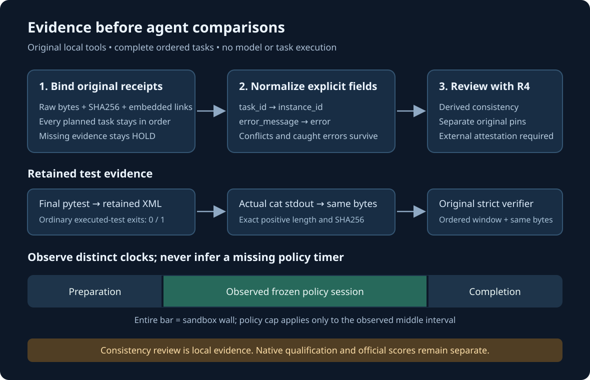

# Gemma 4 Developer Agent: experiments and public notebook

## Completed official result · 14 October

The Budget-Fit V5 coverage-checkpoint experiment completed with **public score 0.18**, above the account's earlier **0.13** best from a different configuration. [Read the completed result and exact archive proof](bfv5-coverage-2026-10-12/RESULT.md): Kaggle submission **57111761**, COMPLETE, with the downloaded scored ZIP matching the original 8,055-byte candidate byte for byte.

The recipe credits Wilmer E. Henao (verracodeguacas), whose upstream V5 scorecard also showed 0.18. Our bounded post-edit checkpoint is an exploratory addition; this single result does not isolate its causal effect. The package includes attribution, runtime settings, a diagram and an exact CPU rebuild. Earlier failed and pending native experiments remain documented separately.

## Earlier snapshot · 12 October

At that snapshot, the latest verified completed campaign score was **0.13**, from the separate D configuration. [Owned prompt feedback](owned-r2-prompt-feedback-2026-10-12/README.md) provides an exact CPU rebuild of a controlled A_think prompt change, practical Bash mechanics and validation evidence. Compiler and scripted-loop checks passed; upload start returned HTTP 401, so the new candidate has no evaluation or score.

## Earlier experiments worth reading

Existing public campaign notebook: [Gemma and the Shape of Doubt](https://www.kaggle.com/code/prvsiyan/gemma-and-the-shape-of-doubt). This stable identity was observed public in the retained 11 October snapshot; the guide makes no current run-status or score claim.

The permanent archive includes [Task-normalized action loss](https://github.com/cubres/gemma-4-developer-agent/blob/bab9fcda703c05bea8fcf90addd8a9c68d907c21/tools/task-normalized-action-loss/2026-10-05/README.md) and [Finalization journal](https://github.com/cubres/gemma-4-developer-agent/blob/445b9b57d1b5aa45171b4077212c6da803f10011/finalization-journal-2026-10-10/README.md). Read their original claim limits and provenance before a fork. Failures and unexecuted ideas remain part of the record; invented controls are separate from native qualification and official scores.

The shared [Static notebook execution map](https://github.com/cubres/gemma-4-developer-agent/blob/4b21f05ee4542c9f0c5a9dfd2a6d7081385af6d7/tools/notebook-execution-map/2026-10-05/README.md) provides a read-only first look at direct configuration bindings. It does not execute notebooks or infer effective runtime.
