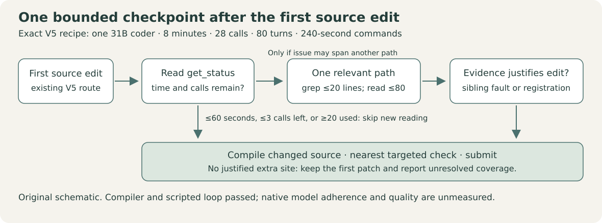

# Budget-Fit V5 with a bounded coverage checkpoint

This is a small, reproducible prompt experiment derived from **Wilmer E. Henao (verracodeguacas), Gemma 4 Agent: Budget-Fit Single Agent, Version 5**, released under Apache-2.0. The original checkpoint is marked at the end of `prompts/system.md`; the model, tools, sampling and clocks stay exactly V5. See `NOTICE.txt` for credit and precise source hashes and `LICENSE.txt` for the license terms.

The question is whether one bounded check after the first source edit can catch a missed sibling implementation or public registration. A correct definition can still be unreachable through the requested namespace or dispatch entry. Extra reading and prompt tokens can also cost time; the diagram describes instructions whose model adherence remains unmeasured.



The checkpoint calls `get_status`. With at most 60 seconds, at most three charged calls remaining, or 20 calls already used, it adds no new reading. Otherwise, when the issue may span another path, it allows one grep of an observed symbol (20 output lines) and one source window (80 lines). A second edit requires evidence of the same fault or a required registration. The existing edit-by-call-12 and submission route remain in force.

## Rebuild the exact source archive on CPU

```sh
python3 rebuild.py --output ../coverage-build
```

The standard-library builder writes `submission.zip` and a local rebuild receipt. It preserves existing output files and stops on source or compression drift. It imports no organizer or model, runs no task, uses no network or API, and submits nothing. The six actual archive members are shipped here as readable files: `agent.yaml`, `configs/sampling.yaml`, `eval_config.yaml`, `prompts/system.md`, `LICENSE.txt`, and `NOTICE.txt`. Only these six members enter the archive; this README, figure, validation summary and builder do not.

Exact archive: **8,055 bytes**, SHA256 `0311b8a71ff9498aaaca30a8a6d22be5622a62539eaef0360dd585d401fe3af9`. The three runtime YAML members match V5 byte for byte. The paired model-free control has the same five nonprompt members, including inert license and credit documents. Those documents are not included in model instructions.

The unchanged recipe uses one coder, **31B QAT with 4-bit weights**, temperature 0.2, top-p 0.95, 8,192 output tokens and 4,096 thinking tokens. It retains nine declared tools, no scout, **8 minutes / 28 charged calls / 80 turns / 240-second commands**, and V5's omitted top-k. The prompt still prohibits graph-tool calls.

## What has actually passed

The released organizer compiler, actual ADK templates and exact tool declarations passed for control and treatment. Scripted original synthetic routing passed in the real agent loop under the 8/28/80/240 contract: five charged calls per arm and zero target-model calls. Negative controls rejected an unknown tool, an unknown model and a six-member archive under a deliberately smaller five-file limit. The portable CPU builder reproduced the exact archive bytes. `VALIDATION.json` pins this scoped evidence.

**Native agent quality is UNMEASURED.** These are format and mechanics checks, not evidence that Gemma follows the checkpoint, completes a real task, or improves a score. No organizer source, wheels, private tasks, private identifiers, credentials or model weights are distributed in this package.

At this source freeze, **no official attempt or candidate score exists**. The upstream V5's observed public notebook scorecard was **0.18**; our separate completed D v4 configuration scored **0.13**. These historical results have different source contracts and are not a measured comparison for this treatment. The preserved native qualification HOLD remains unchanged.

## Preregistered exploratory reading

One distinct official configuration attempt is planned, with the organizer evaluator as the first target-model run. Maximum attempts: one; a consumed attempt is never repeated after an ambiguous result. The registered primary endpoint is the exact completed official row with a nonempty score bound to this archive, or a confirmed terminal organizer execution error. An upload rejection is transport evidence and supplies no agent execution outcome.

Malformed-call frequency, task-completion counts, time/turn/tool exhaustion and checkpoint adherence will be reported only if authoritative evaluator traces expose them and their full denominators. Missing traces stay unavailable. A single draw cannot establish a calibrated gain or a causal advantage over V5 or D v4. Current competition rules, source availability and daily quota must be admitted before the planned attempt.
