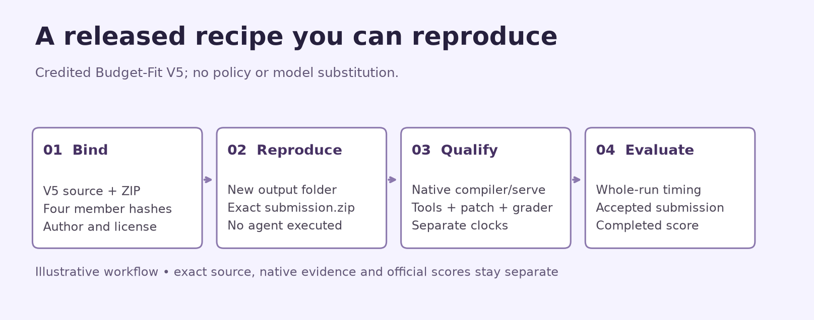
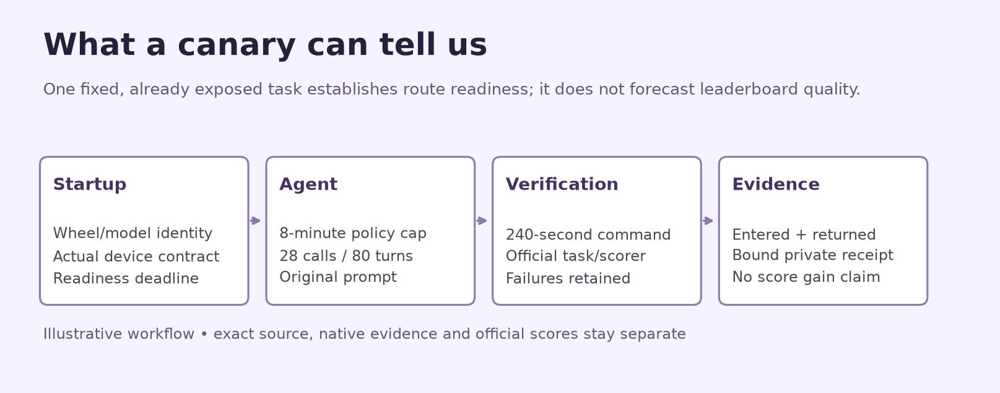
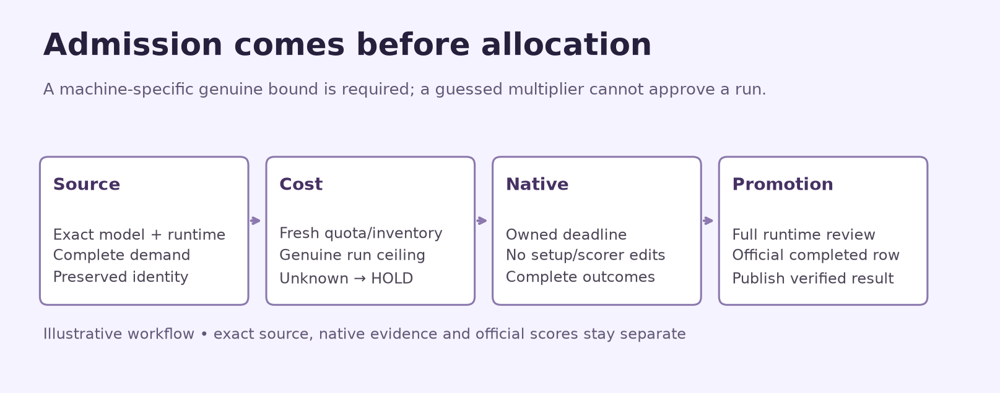

# Budget-Fit V5: exact reference, useful measurements

This small original tool reproduces the credited released [Budget-Fit V5](https://www.kaggle.com/code/verracodeguacas/gemma-4-agent-budget-fit-single-agent?scriptVersionId=355310852) package without executing its agent. The upstream notebook's observed **0.18** belongs to its V5 result. Our reproduction is not a scored submission.

Run `python build_reference_archive.py --output runs/budgetfit-v5-reference` in a new output folder. Only Python's standard library is needed. The resulting `submission.zip` has the exact upstream container hash and four compiler-member hashes; LICENSE, attribution and a reproduction receipt sit beside it. For a local notebook, set `GEMMA_REFERENCE_OUTPUT` to a new local directory. No weights, tasks, models or Kaggle APIs are used by this command.

The recipe uses one coder, 28 calls, eight policy minutes, 80 turns, 240-second commands and 4,096 thinking tokens. The exact model is **31B QAT with 4-bit weights**. Preserving these settings makes this a whole-recipe reference. Altering a prompt, toolset, budget, model or context is a separate experiment and must receive a different package hash.

Measure model readiness, actual request/response parser behavior, task setup, agent generation, commands, patch return, official grading and cleanup independently. A single exposed-task canary confirms a route; it does not estimate held-out quality. Include wrong patches, timeouts and non-entry failures in the registered denominator. Retain the original setup and grader.

Use hardware only after its exact checkpoint, dtype, tensor-parallel layout, memory/context, framework and full allocation cost are qualified. The archive reproducer does not select or allocate hardware. A completed official row supplies an official score; a package hash or notebook output does not.

`PUBLIC_APPEND_CELLS_R2.json` provides original append-only explanatory/configured reproduction cells for the existing campaign notebook. Keep its current opening artwork and all historical cells. Set `GEMMA_REFERENCE_DIAGRAMS` to the directory containing the three PNG assets (`public/diagrams_r2`) after attaching the bundle to a Kaggle fork. The diagrams describe the workflow; they are not measured score charts.

See [NOTICE](NOTICE.md) for exact author/source/version attribution and [LICENSE](LICENSE). The wrapper and diagrams are original Apache-2.0 work; the four reference members remain unchanged. Competition-code availability, terms and privacy must be checked before public distribution through any channel.

To render new copies of the original diagrams, run `python make_diagrams.py --output runs/new-diagrams`. This requires Matplotlib and preserves all existing image files. The shipped PNG/SVG assets are ready to use without rendering.
