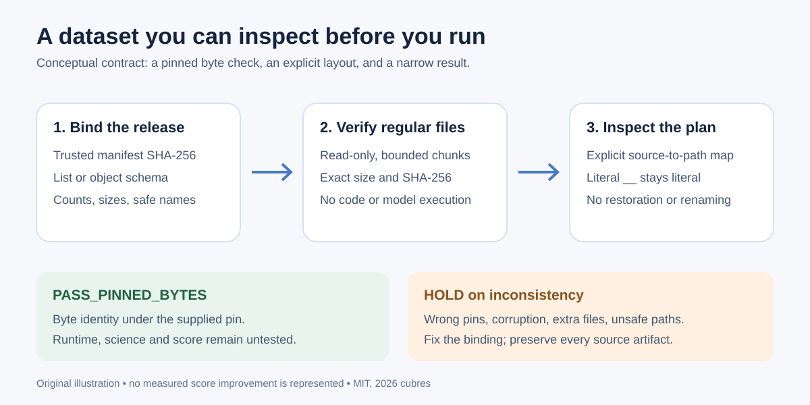

# Verify a flattened dataset before using it

A small, read-only helper for the first minutes after attaching a public code dataset: **verify the exact download, inspect the original folder plan, then choose which code to run**.

`verify_flatpack.py` understands both manifest formats used by the campaign's new datasets. It reads and hashes regular files in bounded chunks. It never runs the downloaded code, loads a model, parses an archive, deserializes a pickle, restores a folder, or changes a dataset. It has no network or credential dependency.



## Try the invented example first

Python **3.10 or later** on macOS or Linux; standard library only. Run from this directory:

```bash
python3 -I -B verify_flatpack.py demo \
  --manifest-sha256 e819545a30f33a3238aa51fcbc946adb4a8ccc0fd7ea45aa0b6840c42efab2dd \
  --layout demo-layout.json
```

The report should say `PASS_PINNED_BYTES`, two verified files, and `PASS_EXPLICIT_MAP`. The planned path for `pkg____main__.py` is `pkg/__main__.py`. That example is deliberate: replacing every `__` with `/` would misread a Python filename containing literal underscores. The tool checks the explicit map and prints it; it makes no directory or file changes.

All example payloads are invented. The example Python file is inert text and is never imported.

## Verify a real pack

Find the manifest digest in a trusted, version-specific release record. Supplying a digest computed from the same untrusted download only proves internal consistency, not that it is the intended release.

```bash
python3 -I -B verify_flatpack.py /kaggle/input/rsna-knee-reader-code-pack \
  --manifest-sha256 f053dcecce930d6ece08ca00d4a8706b2c6d4193cf7371a40e715687893ce254
```

That digest pins the **local staged upload snapshot examined on October 11, 2026**, not an independently refreshed Kaggle version. A different legitimate version will return `HOLD`; verify the new publisher receipt before updating the pin. This helper performs no download or account action.

| Local staged pack examined | Manifest format | Verified files | Verified bytes |
|---|---|---:|---:|
| [RSNA Knee reader code pack](https://www.kaggle.com/datasets/prvsiyan/rsna-knee-reader-code-pack) | List of `{path, bytes, sha256}` records | 21 | 369,430 |
| [Gemma developer agent packages](https://www.kaggle.com/datasets/prvsiyan/gemma-4-developer-agent-packages) | Object keyed by filename | 42 | 95,326 |
| [Hidden-rerun safety kit](https://www.kaggle.com/datasets/prvsiyan/kaggle-hidden-rerun-safety-kit) | List of `{path, bytes, sha256}` records | 19 | 158,955 |

These are read-only byte checks of saved staged files. They certify neither live publication nor the code's behavior. `STAGED_READONLY_RESULTS.json` holds all three exact manifest pins, result scopes and the verifier source hash. That scan used a 30-second CPU cap and measured approximately 0.006 CPU seconds on this host.

## What the report means

- `PASS_PINNED_BYTES`: every manifested regular file matched its recorded SHA-256 and byte count under the supplied manifest pin. No unlisted content was present, apart from the two explicitly allowed metadata names below.
- `PASS_EXPLICIT_MAP`: an optional, complete mapping supplied by the user passed syntax and collision checks. It is a proposed layout, not a proof of the author's intended structure.
- `HOLD`: stop at the reported reason. Fix the source/pin/map with the publisher; the helper offers no mutation, reset, deletion or recovery mode.
- Exit code **0** means the byte check passed; **2** means `HOLD`. Usage errors also exit 2 through `argparse`.

`MANIFEST.json` cannot list itself. An unlisted `dataset-metadata.json` is allowed because two inspected packs exclude it. Its bytes, file type and contents are **unverified**, and the report names that exemption. If metadata is listed, it is checked like every other file. Extra content files, directories, symlinks and device-like inputs do not qualify as verified pack files.

Authentication of the manifest pin is external. Byte identity does not establish provenance, licensing, privacy, numerical correctness, framework compatibility, validation independence or a leaderboard result.

## Make an explicit layout map

Use the exact manifested filenames as keys and ordinary relative paths as values:

```json
{
  "schema": "flatpack-layout-1",
  "manifest_sha256": "<the same 64-character lowercase SHA-256 pin>",
  "paths": {
    "code__runner.py": "code/runner.py",
    "notes.txt": "notes.txt"
  }
}
```

Replace that placeholder with the actual pin. The keys must cover every manifested file exactly once. The tool rejects traversal, absolute paths, backslashes, empty path components, duplicate or case-colliding targets, and a path used as both a file and a parent directory. An explicit mapping preserves literal `__` in filenames. Do not infer the author's layout from a lossy filename convention alone.

After checking the plan, use a publisher-reviewed, non-destructive workflow for any actual materialization. Keep every notebook, version, source directory and identity artifact intact. This package intentionally provides no restore command.

## Bounds and filesystem assumptions

Fixed bounds: **1 MiB** per JSON document, **5,000 files**, **1 GiB** per content file, **2 GiB** total content, **180 ASCII characters** per path component, **16** target-path components and **1,024 characters** per target path. This is aimed at code packs, not very large checkpoint datasets.

The tool opens inputs read-only with POSIX no-follow/nonblocking flags, rejects nonregular manifested files, anchors file opens to the selected directory descriptor, and checks file size/inode/timestamps around each read. It also rechecks root contents and directory metadata. The selected root's parent path is trusted. These checks detect many ordinary races; they do not provide a simultaneous filesystem snapshot or a guarantee against a hostile filesystem that can forge metadata. Work from a stable read-only mount.

Names use a conservative ASCII portable subset; Windows device basenames and trailing dots are refused even though the tool itself is POSIX-only. A failure reports a code rather than dumping local paths or file contents.

## Tests

```bash
python3 -I -B test_verify_flatpack.py --scratch-root invented-controls-normal
python3 -I -O -B test_verify_flatpack.py --scratch-root invented-controls-optimized
```

Choose a new, absent scratch directory for each run. Tests create only invented fixtures and retain them; there is no cleanup or deletion path. Forty-eight controls pass in both modes: corruption, wrong/missing pins, both manifest formats, counts/totals, booleans posing as integers, limits, duplicate JSON keys, unsafe names, case collisions, missing/extra files, symlinks, FIFOs, directory inputs and explicit layout collisions. The byte-preservation control checks that the source fixture is unchanged.

One initial test expected 34 bytes for an invented fixture that actually contained 35. The expected value was corrected; the fixture and verifier were correct. No score, native Kaggle compatibility, hostile-filesystem safety or independent review is claimed by these author-run tests.

Unlike integrity checks written as `assert`, this verifier uses explicit exceptions in both modes. Python omits assertion statements under optimization. [Python language reference](https://docs.python.org/3/reference/simple_stmts.html#the-assert-statement)

## Reuse and attribution

The tool, tests, demo, diagram and documentation were written for this package and are released under MIT. No competition rows, labels, weights, notebook source or third-party code are redistributed. Dataset source terms continue to apply to files you inspect. `CARD_ADDITION_PROPOSAL.md` is a proposed, additive documentation section, awaiting coordinator review and publication; no existing card was edited.
