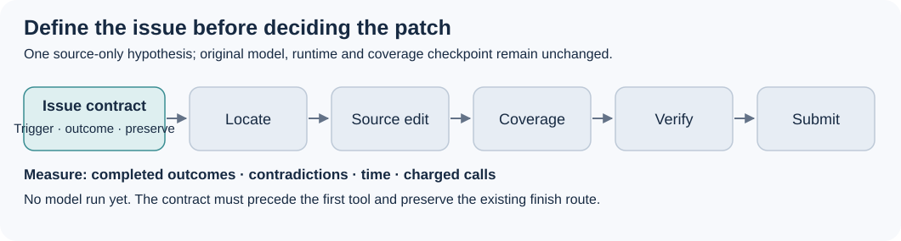

# Before the first edit: a small Gemma issue-contract experiment

This **E03 source candidate, now rebuilt twice on CPU,** prefixes one independently written issue-contract block to the entire scored E01 prompt. E01 completed at **0.18**, exact row **57111761**, ZIP SHA256 `0311b8a71ff9498aaaca30a8a6d22be5622a62539eaef0360dd585d401fe3af9`. That score belongs to E01; **E03 has no model, native or official result**.

The complete new block is **50 whitespace-delimited words including its heading**; its body is 47 words. It asks for a contract of at most 50 words before the first tool invocation, in the same action: triggering condition, required outcome and one behavior to preserve. Unknown details stay unknown. It does not request another tool call. Whether the model complies or incurs another turn remains a measured outcome.



This differs from E01's post-edit coverage checkpoint and the separately drafted E02 behavioral verification. Neither E01 coverage nor E02 materials are changed. `PROMPT_DELTA.diff` and `NOTICE_DELTA.diff` expose the whole source change. All three runtime YAML files and full Apache licence are byte-identical to scored E01; its original prompt remains contiguous and byte-identical after the prefix. There are exactly six candidate archive members. Current notebook identities and opening artwork are untouched.

The original recipe is Wilmer E. Henao (`verracodeguacas`), [Budget-Fit V5](https://www.kaggle.com/code/verracodeguacas/gemma-4-agent-budget-fit-single-agent?scriptVersionId=355310852), Apache-2.0. Method acknowledgement goes to Dmitrii Gluzdov's [Measure Before You Tune V15](https://www.kaggle.com/code/dmitriigluzdov/gemma-4-measure-before-you-tune?scriptVersionId=357369769), whose D1 combines an issue contract and sibling registration and credits [SuperAgent](https://www.kaggle.com/code/matterhorn3838/gemma-4-superagent). D1 has no independently bound score in the retained audit. This block copies no D1 or SuperAgent prompt text. Full old NOTICE is preserved, with an inert authorship/method addition under Apache-2.0.

The original prefix, CPU builder, diagram and protocol are released under **Apache-2.0**; the [full included licence](candidate/LICENSE.txt) and [retained notice](candidate/NOTICE.txt) preserve upstream terms and attribution.

## Actual CPU rebuild result

Two root-coordinated CPU builds completed successfully and produced byte-identical **8,525-byte ZIPs**, SHA256 `e97d9072134b8217cccfc6511d9f2180f911c6169f6464118977eb2964f7abd9`. Each verified the unchanged accepted E01 wrapper roundtrip at 8,055 bytes / `0311…3af9`. [REBUILD_RESULT.json](REBUILD_RESULT.json) and [CPU_BUILD_RECEIPT.json](CPU_BUILD_RECEIPT.json) bind the exact source, builder and six member hashes. The builds used Python 3.12.14 and zlib 1.2.12.

This proves source packaging and determinism in that environment. It establishes no model adherence, task repair quality, native qualification or official E03 score. The included `SOURCE_MANIFEST.json` is the historical pre-build source freeze, preserved exactly because the builder binds its hash; this follow-up records the subsequent actual CPU outcome. The author did not run the builder; root performed these two builds after independent source review.

## Rebuild after source review

`rebuild_e03.py` is original standard-library code. It verifies the exact scored E01 ZIP and every member, the frozen candidate files and the only two allowed changes before writing exclusively to a **fresh** output directory. Existing destinations are refused; partial builds remain preserved. No models, network, subprocesses, notebook edits or submission routes are involved.

```sh
python3 -I -B rebuild_e03.py \
  --accepted-zip /absolute/path/to/the/exact/scored/e01.zip \
  --out /absolute/path/to/a/fresh/e03-build
```

It writes the six source members, `submission.zip` and `BUILD_RECEIPT.json`. Fixed member order, 1980 timestamps, 0644 permissions and **ZIP_DEFLATED** retain E01's wrapper. Before any output, the builder reconstructs the unchanged accepted archive in memory and requires its bytes to match the original 8,055-byte ZIP exactly; a Python/zlib environment that cannot reproduce it is refused. The receipt records both versions. Root must verify compiler compatibility before native evaluation. To verify deterministic bytes, root may compare receipts from two separately named fresh builds. The author has not executed this builder. The two completed builds above were coordinated by root.

## One paired protocol

`PAIRED_PROTOCOL.json` is a **draft**, not a preregistration or launch qualification: task IDs and exact runtime/rights/quota bindings are still unset. Compare unchanged E01 against only this E03 prefix with the exact same model, sampling, nine tools and 8-minute / 28-call / 80-turn / 240-second configuration. Freeze explicit eligible public-development IDs and exclusions before model use; alternate arm order. Record completed outcomes, contract timing, contradictions, first-edit time, charged calls, elapsed time and unfinished tasks. A tiny screen can reject a weak idea; it cannot establish a score gain. Never repeat accepted row 57111761 as a control or monitoring action.
