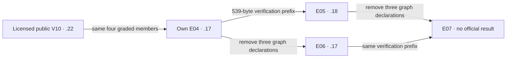

# Gemma E07: verification with six tools

E07 combines the exact scored E05 final-edit verification prompt with the
exact scored E06 six-tool declaration. It changes three YAML declaration
lines relative to E05. The31B quantized model alias, sampling,4096 thinking
budget,28 calls,8 minutes,80 turns and240-second command timeout stay fixed.
The source is Apache-2.0; the unchanged input LICENSE and NOTICE preserve
Igor Zharov/flexonafft, matterhorn3838, official/community and earlier project
credits. No weights, wheels, benchmark tasks, gold patches, credentials or
private traces are included.



These historical official scores are separate unpaired draws. They do not
identify a causal effect or demonstrate an E07 gain. Public
[V10/native357955943](https://www.kaggle.com/code/flexonafft/gemma-4-budget-aware-coding-agent-v2?scriptVersionId=357955943)
and its Apache2 license/source were freshly bound on20October2026. Own
[E04/V31](https://www.kaggle.com/code/prvsiyan/gemma-and-the-shape-of-doubt?scriptVersionId=358738566),
[E05/V32](https://www.kaggle.com/code/prvsiyan/gemma-and-the-shape-of-doubt?scriptVersionId=359522074)
and [E06/V33](https://www.kaggle.com/code/prvsiyan/gemma-and-the-shape-of-doubt?scriptVersionId=359872054)
are exact version references. V10 is the known qualified public baseline,
not a claim about the global best or our achieved score.

The included **actual CPU canary receipt** reports60 checks passed in
0.634681 seconds, observed peakRSS82,690,048B, with zero model requests,
tool executions or network attempts. Two new producer fixtures gave the same
3890-byte ZIP, SHA256
`e0f17eb9b96dbd341fa60d04e0be06770f8a75ab815feee25b25304d42f44c6d`.
The pinned official compiler used inert ADK/model/tool fixtures and real
GenAI configuration types. Graph-present and graph-absent prompt branches
were checked. This measures packaging/configuration, not Google ADK runtime,
model adherence, task resolution, native compatibility or an official score.
RSS was an observed acceptance gate, not a hard memory sandbox.

`input/` contains exactly eight flat files. The entrypoint checks their
membership and source pins before creating the four graded ZIP members and
a bounded ASCII public contract. The two evidence JSON files beside this
README are deliberately outside `input/`, because the producer rejects
unexpected input members.

For a local **stdlib-only packaging example**, first provide a newly created,
empty output directory outside the kit. Set the two absolute paths below:

```python
from pathlib import Path
import runpy

release = Path('/absolute/path/to/this/release').resolve(strict=True)
kit = release / 'input'
out = Path('/absolute/path/to/precreated-new-empty-output').resolve(strict=True)
assert out.is_dir() and not any(out.iterdir()) and not out.is_relative_to(kit)
module = runpy.run_path(str(kit / 'e07_cpu_packager.py'))
receipt = module['build'](kit, out)
print(receipt['archive_sha256'])
```

This example creates only `submission.zip` and `e07_public_contract.json`
with exclusive creation. It does not run a model or invoke a canary. ZIP
compression bytes must still be bound in the actual native environment.

The unchanged `SOURCE_INPUT_BUILD_MANIFEST.json` and input README retain
UNPUBLISHED/null-ID statements as **immutable build-time provenance**. They
are not claims about availability at the time you read this release. Actual
GitHub/public Kaggle ID/version/byte qualification belongs in a separate root
publication receipt, without modifying these build artifacts. Intended new
Kaggle input: `prvsiyan/gemma-e07-verification-six-tools`, title
**Gemma E07 Verification Six Tools**; only the eight flat input files belong
in that dataset.

E07 has no official result in this release. Its notebook source proposal is
stopped until root qualifies the public input and final candidate. Fresh
rules, rights, daily submission capacity, preservation, actual SDK size,
native source/output review and exact-version notebook-menu submission gates
remain separate. This source release grants no run or submission authority.
