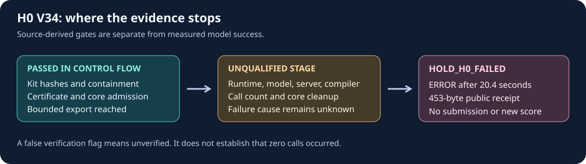

# H0 native canary: a reproducible failure boundary

The [public notebook V34](https://www.kaggle.com/code/prvsiyan/gemma-and-the-shape-of-doubt/log?scriptVersionId=360225179) ended with **ERROR after 20.4 seconds** on the native **GPU L4 x4** profile. It exported only a 453-byte `h0_public_receipt.json` reporting `HOLD_H0_FAILED`. This was a compatibility canary, with no competition submission or new score. The failed attempt remains closed.



## What is reproducible here

The [immutable V1 source kit](https://github.com/cubres/gemma-4-developer-agent/tree/25827ba19a82c5cb62273ba774fa46e8d46a398a/sourcekits/h0-offline-v1) is also a [public Kaggle dataset, version 1](https://www.kaggle.com/datasets/prvsiyan/gemma-h0-endpoint-compatibility-kit/versions/1). Its original helper, core, serializer, licence and notices remain unchanged. The notebook's parsed published source matched the reviewed candidate; publication changed JSON whitespace only. All historical source cells and opening artwork were retained.

This report records a native-UI observation, not a downloaded copy of the remote artifact. `observation.json` is our structured report; it is **not** the original 453-byte receipt and carries no claimed hash of that remote file. Inspect it with standard Python:

```bash
python -m json.tool observation.json
```

## Useful findings and limits

The pinned helper prints its bounded-export marker only after physical bundle discovery, manifest/member hash and containment checks, certificate checks and private core-copy admission. The native log marker and published source therefore support those control-flow conclusions. This is a source-backed inference; it does not expose the native mounted-version header or prove model/runtime success. The observed failure status also implies that the helper's outer cleanup routine returned true, rather than its cleanup-failure branch. That is not an independent descendant census or proof of the core cleanup receipt.

The three required host wheels were acquired from exact public wheelhouse V31 and matched the source kit's frozen hashes. Their inspected API signatures matched the calls made by the core. This does not establish the availability or compatibility of all dependencies in the pinned image.

**The failure cause is unknown.** The failure constructor sets `actual_call_count_verified` to false without recovering the call count; false means **unverified**, not zero calls. GPU inventory, ABI checks, model loading, server startup, compiler/tool round trips and the core's final cleanup remain unqualified. No thinking-clipping, speed, repair-quality or leaderboard improvement is established.

## Next experiment

A proposed diagnostic would preserve every original acceptance predicate, timeout, source pin and public receipt schema. A separate observer would emit only one fixed stage enum derived from bounded private milestone artifacts after the original helper returns, preserving its exit code. There is no diagnostic candidate, runtime result or new launch authority in this report.

The kit's Apache-2.0 terms cover its own code. Google model terms and each third-party package's terms remain separate; this report grants no additional rights to weights or wheels.
