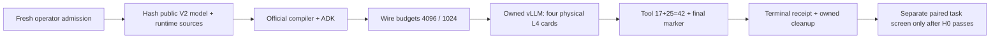

# H0: qualify the real Gemma endpoint before comparing agents

**Unexecuted source release: no new score.** The results below were verified
in the 19 October 2026 campaign audit. This harness checks the official
compiler, ADK runner and public 31B model with at most four invented requests.

Our licensed control is Igor Zharov / flexonafft's
[BudgetAware V10](https://www.kaggle.com/code/flexonafft/gemma-4-budget-aware-coding-agent-v2?scriptVersionId=357955943):
**0.22**, native 357955943, Apache2.0. Acquired source SHA256:
`ec76bd9a4dedc4626bee9d31781469023e6cfe29b666afd095dff5723f717e7b`.
Unknown upstream scored weight bytes are not a byte-identical reproduction.

Our [E06 / V33](https://www.kaggle.com/code/prvsiyan/gemma-and-the-shape-of-doubt?scriptVersionId=359872054)
completed at **0.17**, row 57374841; it did not improve verified **0.18** E05,
row 57329048 / [V32](https://www.kaggle.com/code/prvsiyan/gemma-and-the-shape-of-doubt?scriptVersionId=359522074).
These unpaired organizer draws establish no causal tool-count gain. Notebook
identity, history and existing opening art remain preserved.

Run the unchanged driver with model
`google/gemma-4/Other/gemma-4-31b-it-qat-w4a16-ct/2` and original image
`gcr.io/kaggle-private-byod/python@sha256:37c64f7dd9c54116ecd1bcc88817c5469b88387388fade02bfa8bf3fc647d461`.
The coordinator must externally pin and verify that image; the driver does not
enforce a Docker-image predicate.
It reads `metric/gemma-4-developer-agent-wheelhouse`; exact three official wheel
names/hashes live in `run_h0.py:WHEELS`. Mounted model/tokenizer files and nine
serving-package identities are captured/rechecked before generation. Actual
host ABI and startup are still unqualified. Models/wheels/tasks are not rehosted.

Budgets are 1,050 native seconds and 900 owned seconds including setup/hash/startup/checks
and cleanup, 64 GiB aggregate host RSS, 4,200 whole-allocation raw GPU-seconds and
8,400 conservatively reserved quota-seconds. The actual billing factor is unverified.
Two budgets each exercise an invented tool roundtrip; the proxy permits at most
four actual nonstreaming generation requests, with max_tokens=8192. **Forwarded
controls, processor source presence, real token clipping and repair quality are
separate claims.** H0 proves neither clipping, speed nor a competition score.

The candidate refinement is a smaller thinking cap while keeping prompt, model,
output cap, sampling and tools fixed. A later paired public-task screen must bind
licensed immutable tasks and exact model/runtime hashes, balance arm order and
measure resolution/tokens/time. It has not run; no gain or novelty is claimed.

See [FORK_AND_REBUILD.md](FORK_AND_REBUILD.md) for runnable operator instructions.
`ROOT_H0_ADMISSION.json` deliberately rejects. It is neither a secret nor an
evergreen grant. Earlier source/publication-contract review passed 12 CPU fixtures;
those checks did not execute H0. No new GPU/job or submission is created here.
Original source is Apache2.0: [LICENSE](LICENSE), [NOTICE](NOTICE).
