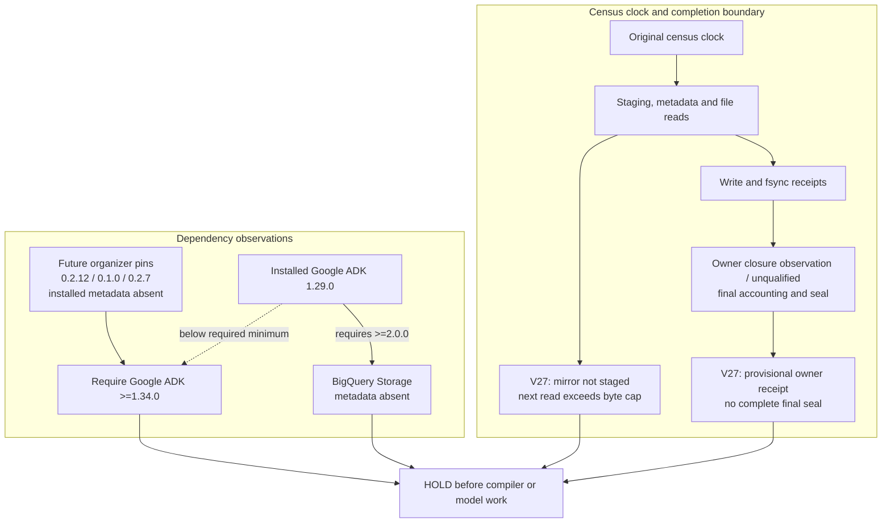

# V27 dependency census: an environment failure before agent evaluation

On 13 October 2026, the CPU-configured V27 dependency census stopped with `HOLD_CENSUS_INCOMPLETE`; the native notebook status was `ERROR`. It never reached organizer or compiler import, model execution or task evaluation. This experiment supplies dependency evidence and a useful failure diagnosis, with no new agent-quality result or official score.

## What the native environment showed

| Check | Observed result | Consequence |
|---|---|---|
| Interpreter | CPython 3.12.13, Linux x86-64 | An actual native observation; it does not establish compiler-startup equivalence. |
| Intended organizer versions | `adk-submission` 0.2.12, `adk-eval-core` 0.1.0, `swegemma` 0.2.7 | These are the pinned future mirror versions. All three distributions were absent from the inspected installed metadata roots; they were not installed or staged by this census. |
| Google ADK | Installed metadata reported 1.29.0 | The three pinned wheels require Google ADK >=1.34.0. The baseline version is below that minimum. |
| BigQuery Storage | `google-cloud-bigquery-storage` metadata absent | Installed ADK 1.29.0 declares the unconditional requirement `google-cloud-bigquery-storage>=2.0.0`. This is a required dependency edge, not an optional-extra warning. |
| File census | 12,076 recorded files; 524,743,295 cumulative read-accounted bytes | The next read was refused by the 536,870,912-byte (512 MiB) cap, leaving the dependency inventory incomplete. |
| Compiler inputs and lock | Mirror not staged; lock awaiting review | No compiler-input join or reviewed dependency lock was produced. |

The file cap is an I/O accounting limit, not a memory measurement. Unique file-inventory entries totalled 507,178,862 bytes. The additional 17,564,433 read-accounted bytes came from interpreter, initial metadata, RECORD and startup-hook reads. Their different totals reconcile; neither total certifies the whole dependency closure.

PyArrow 24.0.0 was the only selected distribution whose recorded traversal was incomplete. That supports the narrow inference that the cap interrupted its traversal. The rejected next filename was not retained, so this experiment cannot identify the exact rejected file or claim that PyArrow itself malfunctioned. No timeout or CPU kill was established.

## Read the clocks separately

The child census recorded 19.7424 seconds before report serialization. The owner tail recorded 21.7457 seconds and 10.9130 seconds of owner-invocation-plus-child CPU after receipt fsync, before stdout. The captured UI displayed 44 seconds for the notebook. These are different intervals; the UI duration is not the census clock.

The provisional owner receipt reported one owned process with one thread, a host baseline and maximum of 17 threads, and peak sampled host-plus-child RSS of 219,090,944 bytes. It also reported closure before reap. A complete final owner seal, receipt digest in the tail and post-stdout accounting were absent, so those observations do not certify whole-run closure or hard startup/resource bounds. The admitted census scope was 120 seconds of census wall time, 60 seconds of invocation-plus-child CPU and 2 GiB of sampled host-plus-child RSS; this failed run is not a resource-contract PASS.

The child reported exit code 2. The later read-only output reader completed with exit code 0; its separate completion record was written at 2026-10-13T16:44:11.813Z. Reader success means the retained error evidence was read successfully; the native V27 result remains `ERROR` and `HOLD`.

## What a bounded successor must resolve

Check installed metadata against the exact intended wheel versions before attempting compiler imports. Separate missing baseline organizer metadata from future source mirrors, and keep required dependency edges distinct from conditional extras. Stage a verified compiler-input mirror explicitly; an unstaged source plan is not a native input join.

For any later census, record the current distribution, rejected proposed read size, cumulative budget and remaining dependency queue when a bound stops traversal. Distinguish cumulative reads from unique pinned files. A narrower deterministic inventory may reduce duplicate work, but it has not run and must retain an explicit incomplete status for anything omitted. The present evidence authorizes neither a larger cap nor package installation, a new launch, compiler execution or submission.

## Evidence and reproduction scope

This note combines the exact retained native output read, its separately observed reader completion, an independent 25-check static diagnosis, and direct inspection of the three pinned wheels' METADATA without importing their code. The raw census, private process receipts, runtime paths, account metadata and transport bodies remain private. No wheels, weights, task data, source mirrors or executable launch code are distributed here.

The retained native read receipt has SHA256 `bd783830e146460f19271f28a4c0bf28c9466e17b6831b48c1d70ac97051974f`; the independent diagnosis has SHA256 `de780ab085b5f2a0fd2c40ac0b9cfc261d4809dc8eb90f1643f92bb8377a21e3`. These identify privately retained evidence, not publicly downloadable reports. The native census and owner source are not qualified here as public reproduction tools, so this note supplies no launch or installation recipe.
