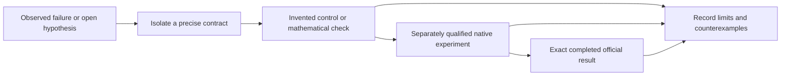

# Five campaigns: an experiment reading path

Useful experiments deserve a permanent place even when they fail or prove less than expected. This guide connects six older original bundles already published in the separate campaign repositories. Every link is pinned to its published commit, so the historical record remains readable as the campaigns advance.

| Campaign | Start here | What it teaches | Evidence boundary |
|---|---|---|---|
| RSNA Knee | [A hidden-rerun regression, preserved as a failure](https://github.com/cubres/rsna-knee-abnormality-detection/blob/13520e1bf70450378f77909fc41f46d08fa67447/hidden-rerun-regression-2026-10-09/README.md) | Why a small visible qualification can miss a hidden-rerun regression. | The historical completed V25 result was 0.505; its exact causal explanation remains unproven. |
| Gemma | [Task-normalized action loss](https://github.com/cubres/gemma-4-developer-agent/blob/bab9fcda703c05bea8fcf90addd8a9c68d907c21/tools/task-normalized-action-loss/2026-10-05/README.md) | Equal task and trajectory weighting before any real supervised training. | Invented controls; training_ready=false; no native repair-quality result. |
| Enveda CASMI | [Energy-balanced projection](https://github.com/cubres/enveda-casmi-2026/blob/0c5cf4615cf1de050e7e3dc769630c5b760f284b/tools/energy-balanced-projection/2026-10-05/README.md) | Keep molecule and collision-energy weighting explicit when measurements are unbalanced. | Synthetic numerical loss/gradient/update checks; no chemistry or leaderboard claim. |
| ARC-AGI-2 | [Stable seed binding](https://github.com/cubres/arc-prize-2026-arc-agi-2/blob/8c4193dbbd45802e1256b2e46d70fe89f2c74fbc/tools/stable-seed-binding/2026-10-06/README.md) | Reproduce seed bindings without mistaking a reduced seed for a unique identity. | A standalone component; no solver integration or answer-quality result. |
| ARC-AGI-3 | [Correspondence uncertainty](https://github.com/cubres/arc-prize-2026-arc-agi-3/blob/bf015d418d5b4e2661b4333d6e771c80494cbe45/tools/correspondence-uncertainty/2026-10-06/README.md) | Abstain when object assignments admit equally cheap explanations. | Synthetic geometry; separation under a cost model is not verified game movement. |
| Shared reader utility | [Static notebook execution map](https://github.com/cubres/gemma-4-developer-agent/blob/4b21f05ee4542c9f0c5a9dfd2a6d7081385af6d7/tools/notebook-execution-map/2026-10-05/README.md) | Inspect direct configuration bindings before spending compute. | Static partial map; embedded scripts and effective runtime are outside its scope. |

## Read in this order

1. Read the bundle's limitation paragraph and provenance before its implementation.
2. Run its documented invented or mathematical controls in a fresh local output folder, where the tool requires one. Those controls are separate from a native competition run.
3. Change one mechanism, record the source and dependency hashes, and state which claim the experiment can actually test.
4. Treat a completed native run and an exact completed official score as separate evidence. Preserve failed runs and unexecuted ideas with their original dates and honest status.

The arrows describe a workflow, not a claim that every linked bundle reached every step. An unsuccessful experiment can still provide a useful counterexample, a reusable checker or a clearer data contract. Original artwork and notebook identities remain preserved.

These older snapshots are deliberately left intact. This guide supplies navigation; it introduces no new model, private run output, data release, source reimplementation or score improvement.
