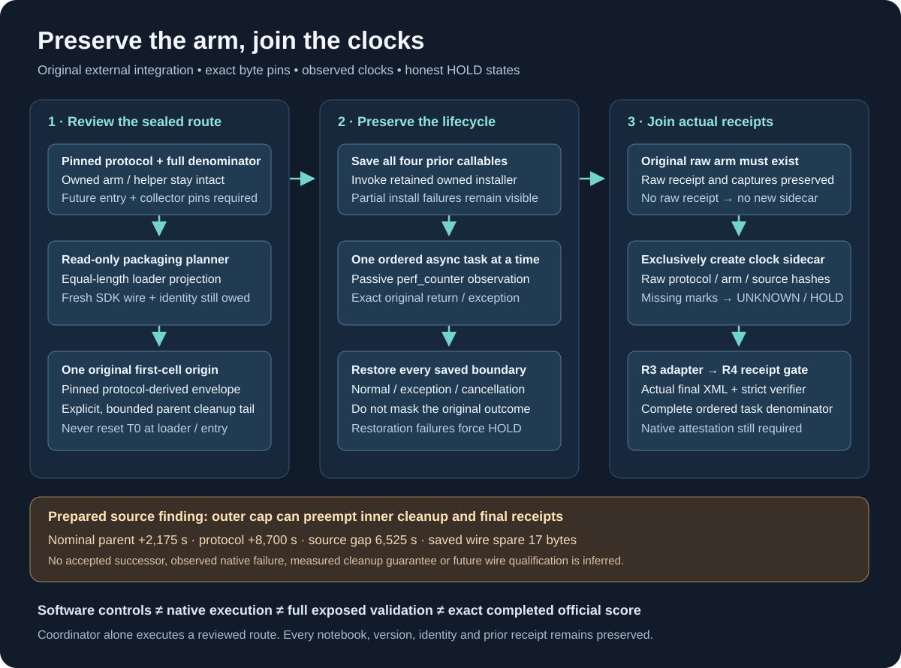

# Preserve the arm, join the clocks

This original small package closes two practical gaps in a developer-agent evaluation workflow: preserving the evaluator's callables around an external observer, and checking that an enclosing bootstrap actually allows its inner watchdog to finish.



The existing owned `native_arm.py` stays byte for byte intact. The join saves its timing installer and three evaluator boundaries, invokes that installer, then places the previously reviewed passive clock collector around the resulting async sandbox call. It restores every saved callable on success, ordinary exception, partial installation failure and cancellation. The original task return object and exception are preserved.

The join refuses concurrent calls, conflicting task aliases and tasks outside the declared order. A skipped task or missing context mark stays missing. It never replaces a missing observation with zero or estimates policy time from total task duration.

After the owned arm has written its original raw receipt, the join may exclusively create a separate `PRIVATE_POLICY_CLOCK_RECEIPT.json`. That sidecar contains raw protocol/arm hashes, the reviewed source pins, actual `time.perf_counter` marks and restoration/error counts. It retains an explicit HOLD for incomplete clocks, caught errors, unsupported pytest exits or lifecycle failures. A complete clock sidecar still requires source review, full receipt collection and native attestation. It is not a submission artifact or a score.

## Files and boundaries

| File | Purpose | Executes an evaluation? |
|---|---|---|
| `entry_join.py` | Checked coordinator API, restoration lifecycle and new sidecar | The dormant `execute_checked_arm` API can invoke the exact retained owned arm after checks; its CLI always returns HOLD |
| `entry_command.py` | Reads the pinned route and returns a literal argv list | No; only a separately authorized coordinator may execute that argv |
| `bootstrap_budget.py` | Derives an enclosing timeout from the original first-cell origin and a pinned protocol | No |
| `route_planner.py` | Reads a prepared build and inspects restricted AST/metadata/byte contracts | No; CLI reports HOLD |
| `test_entry_join.py` | Invented async evaluator/context/receipt controls | Invented fakes only |
| `test_entry_command_budget.py` | Invented deadline controls and tiny fake-entry subprocesses | Original fake entry only |

No code here submits, stops or pushes a notebook, uploads a dataset, modifies an organizer source, deletes a file, or changes a preservation guard. Never adopt a route after a preservation rejection. Preserve every notebook identity and use fresh full server identity and terminal-status checks before any separately authorized in-place push.

## Run the invented controls

Use Python 3.12 and the separately reviewed original collector from the sibling public `native-receipt-adapter-2026-10-11` package. The test loader checks its exact SHA-256 before compiling those same bytes. It never imports an organizer package or reads competition tasks.

```sh
GEMMA_CLOCK_COLLECTOR="$PWD/../native-receipt-adapter-2026-10-11/clock_collector.py" \
  nice -n 5 python3.12 -B -m unittest -v test_entry_join test_entry_command_budget
```

Fixtures are retained in new directories under `retained-invented-fixtures`. Set `ENTRY_TEST_OUTPUT` to choose another trusted fixture parent. There is no destructive cleanup. A coordinator should apply an explicit CPU and wall limit; the retained author checks used nice +5, 20–30 CPU seconds and a 30-second wall limit per test subprocess.

The author ran 33 lifecycle/planner controls and six subsequent command/budget controls under normal Python and `-O`. Both groups passed. The latter executes the original child glue against a tiny invented entry, never the real native API. These controls establish local software behavior only.

## Read-only prepared planning

`route_planner.py --manifest <private-manifest.json>` reads a bounded manifest of exact source/receipt pins. It verifies the saved full identity, dataset identity, protocol/build bindings, ordered preregistration prefix, loader asset pin and saved wire arithmetic. It simulates an equal-length loader filename/pin change in memory and checks every other cell, metadata field and output remains unchanged. It writes no notebook or asset and performs no SDK/network request.

The retained prepared build has a nominal parent cap of 2,175 seconds from its original first-cell mark, while its inner protocol budgets 8,700 seconds. The 6,525-second difference is a pinned source finding. It can preempt cleanup and final receipt creation; no accepted successor run or observed native failure is inferred from it. The saved SDK wire spare is 17 bytes. Equal notebook byte length is a planning constraint; actual future SDK wire length remains unmeasured.

The static clock reader recognizes a restricted affine expression and the exact one-second timeout floor. Its guard scan is syntax evidence. Dynamic aliases and global mutation are not semantically proven absent. An unrecognized expression or floor becomes UNKNOWN/HOLD.

## Adoption remains HOLD

Adoption requires a new independently reviewed external bootstrap and sealed packet inventory. The protocol must pin this entry, the command glue, the budget utility and the reviewed collector; the existing prepared protocol does not contain the entry/collector bindings. The new supervisor route must call the external checked entry rather than bypass it through the original direct arm command. The retained owned arm, helper and organizer sources must remain unchanged.

The parent timeout utility requires a new explicit `entry_parent_cleanup_tail_seconds` field. It rejects unknown, boolean, nonfinite or reset origins, refuses an exhausted deadline, and bounds the tail by the declared session headroom. It uses current top-level protocol fields and never falls back to the stale historical `timeout_budget` block. Tail arithmetic is a reviewed allocation assumption, not a guarantee of cleanup duration.

The checked route requires all nine frozen source pins, the exact helper and complete preregistration, one arm, concurrency one, Python 3.12 and exact installed serving-package versions. Runtime paths and the port must match the private manifest. Module names/path hashes and wrapper flags are consistency checks, not authenticity credentials.

The coordinator must trust and control the output parent and its ancestors, with no concurrent writer. The raw arm file may not be a symlink. Exclusive creation rejects an existing sidecar or symlink; a failed partial sidecar write is retained for audit. The code does not establish hostile-filesystem safety or cryptographic native authenticity. Admission and route-status reports retain `native_authenticity_established: false`, `official_score: null` and `submission_authorized: false`.

Only after actual raw final XML bytes, the complete ordered task denominator, original strict-verifier evidence, source/runtime/teardown/preservation gates and native receipts have passed independent review can a coordinator consider an exposed validation or submission. Eight-task screens, full exposed validation and exact completed official rows remain separate.
