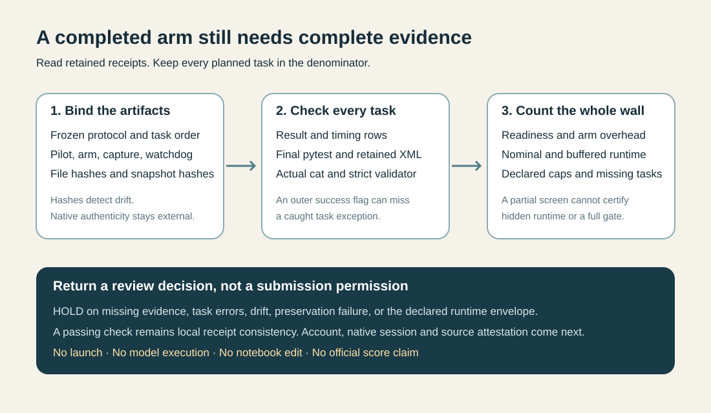

# A completed arm still needs complete evidence

`screen_gate.py` checks a retained Gemma native screen before anybody interprets its runtime. It is a small, standard-library tool that reads five hash-pinned JSON artifacts and prints aggregate diagnostics. It runs no model, task, shell command, notebook, or submission. Python 3.10 or later is required.

The immediate problem is a missing denominator. A native evaluator can catch a task exception and return an error-bearing task result. The surrounding arm may return normally. Its single `infrastructure_error` flag can remain false, while a capture summary says that the final verification calls it observed were retained successfully. Neither statement proves that every planned task reached final verification.

This tool requires the exact planned task order in the result rows, timing rows and final pytest events. It separately checks task errors, final XML captures, the zero-exit cat/validator chain, and a strict-validator witness for a claimed resolved task. Final pytest exits must be 0 or 1. Interrupted, internal-error, usage-error, no-tests-collected and other exit codes yield `HOLD`, even when a retained XML file exists. An ordinary failed-test result stays in the planned denominator and is allowed as an unresolved task; a task error makes infrastructure-free execution unproven and yields `HOLD`. This is a conservative admission rule, not a taxonomy of every possible task error.



## Run the invented controls

```bash
python3 -B -m unittest -v test_screen_gate.py
python3 -B -O -m unittest -v test_screen_gate.py
```

All fixtures are invented. They cover caught task errors with a false aggregate flag, missing final verification despite a capture PASS, incomplete rows, reordered tasks, altered XML chains, timeout, malformed JSON, nonfinite timings, preservation failures, and runtime projections that disagree once unmeasured arm overhead is counted. No real task archive or model is needed.

## Check your own private artifacts

Prepare a private JSON manifest with exactly `plan` and `files` keys. `files` contains the five roles below; each role has only a `path` and a full lowercase `sha256`. Relative paths resolve beside the manifest. Compute the hashes from the retained files you actually intend to review, after checking their account, notebook version, native session and candidate provenance.

| Role | Retained artifact |
| --- | --- |
| protocol | Frozen `PROTOCOL.json` |
| pilot | `PRIVATE_NATIVE_PILOT_RECEIPT.json` |
| arm | `PRIVATE_NATIVE_ARM_RECEIPT.json` |
| capture | `PRIVATE_VERIFICATION_CAPTURE_RECEIPT.json` |
| outer | `PRIVATE_OUTER_WATCHDOG_RECEIPT.json` |

The `plan` object has `schema_version: 1`, `repo`, `arm`, ordered `task_ids`, ordered `full_gate_task_ids`, and `runtime_assumptions`. For the inspected experiment, the assumption keys are:

```json
{
  "hidden_task_count": 120,
  "startup_seconds": 900,
  "margin_multiplier": 1.25,
  "session_limit_seconds": 43200,
  "nominal_projection_limit_seconds": 37800,
  "agent_sandbox_max_seconds": 227,
  "verification_and_residual_setup_mean_limit_seconds": 100
}
```

These numbers are declared experiment assumptions. They are not freshly verified competition rules or a guarantee about the hidden task count, hardware or timeout accounting. Set them from your own confirmed protocol. The checker targets the inspected single-arm receipt schema, including its 30-second cleanup reserve; it is not a generic validator for arbitrary notebook receipts.

```bash
python3 -B screen_gate.py --manifest private-manifest.json
```

The process returns 0 for `SCREEN_CHECKS_PASS_REVIEW_REQUIRED` or `EXPOSED_GATE_CHECKS_PASS_REVIEW_REQUIRED`, and 2 for `HOLD`. Every output still says `submission_authorized: false`, `native_authenticity_established: false`, `hidden_runtime_guaranteed: false`, and `official_score: null`. A successful local check is an invitation to review its provenance, not permission to submit.

## Three different time questions

The installed wrapper measures `_run_agent_sandbox`, which includes that call's setup; it does not isolate the policy's nominal thinking budget. The residual setup field is task total minus agent-sandbox and verification time. The tool retains those labels.

The projected mean uses the whole arm wall time divided by its planned task count. This includes imports, process start and receipt work outside the timed evaluator calls. Startup uses the larger of the declared startup allowance and measured verified-readiness time. Two projections are shown separately:

1. Nominal: startup plus task count times measured arm mean.
2. Buffered: startup plus task count times measured arm mean times the declared margin.

A screen can fit a nominal 10.5-hour target while failing a buffered 12-hour target. The tool holds that case. It also displays the projection if every task uses the declared per-task cap. A cap that does not fit is disclosed even when the measured mean fits; no hidden-runtime guarantee follows.

An eight-task screen can be useful for detecting a runtime regression. It cannot certify a sixteen-task gate, repository diversity, hidden transfer, or a leaderboard score. The output retains the missing full-gate count. Even a complete exposed gate remains local evidence.

## Limits and privacy

SHA-256 bindings detect byte drift only after a trusted coordinator identifies the correct artifacts. A forged, internally consistent receipt can pass; this tool cannot attest that its timestamps, callbacks or model came from a real native session. It compares declared XML hashes and validator receipts rather than opening raw XML or rerunning tests. Quota, competition rules, native account/version binding, trial selection, task representativeness and submission permission remain external checks.

Input reads and declared individual XML captures are limited to 8 MiB. Parsing rejects duplicate JSON keys and nonfinite constants. Each cat/validator XML link must declare the same positive integer byte size and SHA-256 as the retained final XML. There are at most 128 tasks and 4,096 capture events. Diagnostics contain counts, timing aggregates, failure codes and artifact hashes, never raw task errors, prompts, patches, model outputs, file paths or XML. Real private manifests, receipts and repository contents should remain private.

No candidate, notebook, runner or guard was edited to create this package. It has not been integrated into the inspected native pipeline and has produced no new score. See `SOURCE_OBSERVATIONS.md` and `PROVENANCE.json` for the diagnosis and scope.
