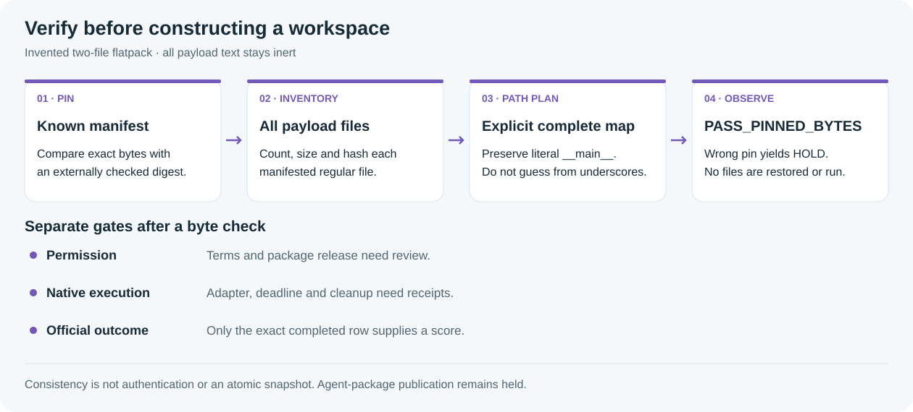

## Before experimenting: know which bytes you have

A read-only warm-up for reproducible artifact handling.


*AI-generated concept art: a paper workshop for reading, building and checking. The typography is original, not an official Gemma logo.*

A reproducible repair experiment starts before the model call: identify the package, the adapter and the evidence separately. This warm-up teaches byte and path checks with two harmless text files. It contains no agent package, prompt or competition task.

### A five-minute learning path

1. Read the notebook’s package and score sections to separate building from evaluating.
2. Run the invented flatpack check. Change only the manifest pin in a throwaway invocation and observe HOLD.
3. Before a real experiment, bind the exact licensed package to the actual harness, execution deadline and final owned-process receipt. Those are separate gates.


*Pinned bytes, a path plan, native execution and an official row answer different questions.*

### Why guessing paths is a bad restore recipe

Flattened filenames are not a reversible encoding. The invented name demo____main__.txt needs to become demo/__main__.txt, while experiment__config.json needs experiment/config.json. Replacing every double underscore would corrupt the literal __main__ component. The reviewed map states the complete desired layout explicitly; this helper verifies that plan and never creates it.

| Invented flat file | Explicit intended path |
| --- | --- |
| demo____main__.txt | demo/__main__.txt |
| experiment__config.json | experiment/config.json |

```python
report = tool.verify(demo_directory, manifest_sha256, layout_json_bytes)
print(report["status"])  # PASS_PINNED_BYTES
# A deliberately wrong manifest pin yields MANIFEST_PIN_MISMATCH.
# No restore, move, import of payload files or command execution occurs.
```

The executed toy checks both file hashes and the full layout map. A one-character change to the expected manifest pin returns HOLD. The fixture names and contents are invented; a production download still needs its own version-bound pin and file inventory.

### The artifact contract

| Boundary | What to bind | What the binding does not establish |
| --- | --- | --- |
| Package bytes | Source terms, externally checked manifest pin, complete file inventory | Permission to redistribute, or model behavior |
| Path plan | Explicit complete source-to-target map | A restored workspace; this tool performs no restore |
| Execution | Actual native adapter, deadline and cleanup receipt | Correctness from a hash alone |
| Outcome | Exact completed official submission row and nonempty score | Transfer from a single local canary |

### Run and fork locally

Python 3.10+ on POSIX, standard library only. Obtain the pinned original helper and retain this companion’s demo directory, demo-layout.json and demo-manifest-pin.txt. The toy reads those files, writes nothing and does not invoke an agent.

```sh
python3 -I -B toy_example.py --tool /your/path/verify_flatpack.py
```

Compare the output with EXAMPLE_RESULT.json. Read-only checks are consistency checks, not authentication or an atomic filesystem snapshot. Use a trusted parent directory and a separately authenticated pin. Successful byte verification leaves scientific validity and native compatibility untested.

### A useful next fork

Keep failures and unfinished attempts in the experiment denominator. Measure localization, command success, final verification and cleanup as separate stages under one bounded deadline. Publish generic tooling and aggregate, privacy-reviewed observations. Gemma developer-agent package publication remains held under Rule 6b; this source-only companion does not release or authorize an agent ZIP or prompt.

### Version, evidence and provenance

Companion revision 1 · 11 October 2026. The reviewed official inventory at 18:27 UTC recorded the account’s best completed public row as 56949760, score 0.12. This scalar snapshot is separate from the toy. It does not establish that this companion or its helper improved the score.

[Existing Kaggle notebook](https://www.kaggle.com/code/prvsiyan/gemma-and-the-shape-of-doubt) · [Campaign GitHub repository](https://github.com/cubres/gemma-4-developer-agent) · [Pinned original helper](https://github.com/cubres/gemma-4-developer-agent/blob/764878bd6d214ef8aedea18a3027793bb9b65273/dataset-flatpack-verifier-2026-10-11/verify_flatpack.py) · [Helper guide and limits](https://github.com/cubres/gemma-4-developer-agent/blob/764878bd6d214ef8aedea18a3027793bb9b65273/dataset-flatpack-verifier-2026-10-11/README.md)

Helper commit: 764878bd6d214ef8aedea18a3027793bb9b65273. Source SHA256: 560eed0c11f1f76a12f8f447d80bbb7130e796aa51fb8854160bd919aabd1b81. Dependency details are in DEPENDENCIES.json; the runnable example checks the source digest before loading it. No internet installation occurs in the toy.

Original companion prose, toy code and diagrams are MIT licensed. The license grants no rights to competition data, checkpoints, organizer or competitor implementations, or branding. The generated opening artwork is illustrative and its exact prompt and bytes are recorded in ARTWORK_PROVENANCE.json. Keep the current artwork and all earlier assets unchanged until the user requests a change.
