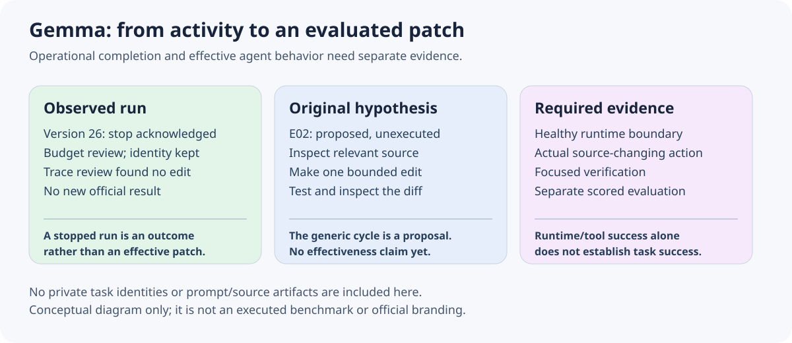

# Gemma Developer Agent progress — 2026-10-11

The Version 26 compute stop was acknowledged for budget review, with the notebook identity and version source preserved. It was not a new official submission or an effectiveness result. The reviewed returned trace did not establish an actual source-changing patch.

The next E02 idea is an original, generic engineering cycle: inspect the relevant source, make a bounded change, run a focused check and inspect the resulting diff. At the pinned audit it was proposed and unexecuted. This note publishes the general learning goal, without the private prompt, returned task identity, trace, organizer artifact or task-specific implementation.

The useful distinction is between a functioning runtime and a useful agent. Starting a server, executing tools or repeatedly asking for status may be observable activity while leaving the code unchanged. A future trial must show the intended source-changing action and its verification before assigning effectiveness. A scored evaluation is a further, separate step; no E02 score or improvement is claimed here.

For a fair experiment, keep the runtime and model contract fixed, declare the generic intervention before execution, record whether a patch was produced, and distinguish a healthy run from task success. Check reproducible install/runtime behavior and the permitted artifact interface before spending another long compute allocation. These are prospective gates, not an executed comparison or advice to reuse a returned task solution.

The prose and diagram are original and conceptual. Raw returned-task traces, identifiers, evaluation-derived metrics, system prompts, code and package artifacts remain private; this progress note grants no redistribution rights. Existing opening art remains unchanged. These are dated observations and an unexecuted hypothesis, not a completed benchmark claim.

[Campaign repository](https://github.com/cubres/gemma-4-developer-agent) · [Gemma Developer Agent competition](https://www.kaggle.com/competitions/gemma-4-developer-agent)
