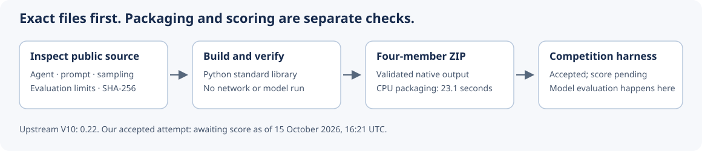

# Reproduce the public Budget-Aware Gemma agent

Four inspectable configuration files, a standard-library ZIP builder, and exact content checks. This is a faithful reproduction of [flexonafft / Igor Zharov’s Budget-Aware Coding Agent V10](https://www.kaggle.com/code/flexonafft/gemma-4-budget-aware-coding-agent-v2?scriptVersionId=357955943).



| Evidence | Result |
| --- | --- |
| Upstream public V10 | **0.22**, observed 15 October 2026 |
| Our faithful [Gemma and the Shape of Doubt V31](https://www.kaggle.com/code/prvsiyan/gemma-and-the-shape-of-doubt?scriptVersionId=358738566) | CPU packaging completed in **23.1 seconds**; exact four-file output validated |
| Our accepted competition attempt | **Score pending** as of 15 October 2026, 16:21 UTC; the native UI showed “Notebook Running” |
| Our previous verified result | **0.17** |

The upstream score is not our score. Packaging time does not measure the competition’s model evaluation or total scoring runtime. The accepted attempt is awaiting its result; no duplicate submission is needed.

## Build and verify

Use Python 3.9 or later. The builder needs only the standard library, uses no network, and does not load a model.

```bash
python3 rebuild.py --output submission.zip
python3 rebuild.py --check submission.zip
```

The first command refuses to overwrite an existing file. The second reads and checks an existing archive without extracting or executing its contents. Both print a small JSON receipt. A changed, missing, duplicated or extra archive member fails validation.

The notebook’s original packager also imports PyYAML to validate its include paths. The independent builder here verifies the already pinned bytes; it does not parse YAML or replace the competition harness.

## What is inside

| File | Purpose |
| --- | --- |
| `bundle/agent.yaml` | Host entry point: one agent, model name, tools and two local includes |
| `bundle/prompts/system.md` | Bounded navigation, early source edits and recovery from exact-match edit failures |
| `bundle/configs/sampling.yaml` | Sampling and thinking budget |
| `bundle/eval_config.yaml` | Per-task evaluation limits |

The host loads `agent.yaml`, resolves `!include prompts/system.md` and `!include configs/sampling.yaml`, and executes the agent with the competition’s model and tools. Merely building this ZIP does not run that process.

The files retain the upstream bytes: `gemma-4-31b-it-qat-w4a16-ct`, temperature **0.2**, top-p **0.95**, **8,192** output tokens, **4,096** thinking tokens, **28** tool calls, **8** minutes, **80** turns and a **240-second** timeout setting. These are configuration values, not measured runtime guarantees. No prompt, budget, tool, model or blend refinement is included.

The prompt’s practical idea is to reserve a bounded opening phase for locating relevant source, require an early edit, and limit later exploration. Its behavior can be inspected directly in `bundle/prompts/system.md`; whether that policy generalizes is an evaluation question.

## Reproducibility and limits

`rebuild.py` pins every member’s full SHA-256 and uncompressed size. It writes sorted paths, a fixed timestamp and permissions, and DEFLATE compression. Archive bytes are deterministic within the same Python/zlib environment; compression versions can differ, so **member hashes establish faithful content**.

The completed Kaggle packaging output contained exactly four members and was **3,713 bytes**, with archive SHA-256:

```text
6ff73d104725cc31deadd18787f3f55e5ce534889cec82387e3b280637d34887
```

The bound upstream notebook source SHA-256 was:

```text
ec76bd9a4dedc4626bee9d31781469023e6cfe29b666afd095dff5723f717e7b
```

Our notebook retained its existing CPU/offline image and unused input mounts. That differs from the upstream environment, although the emitted archive members match exactly. The competition harness and served model revision are not frozen by these four files. Score comparisons therefore remain empirical.

The four-file archive intentionally contains no license, README or diagram. Attribution and the complete Apache license accompany it here and in the notebook. Do not add repository documentation to the competition archive.

## Attribution

The reproduced configuration and prompt are licensed under **Apache License 2.0**. See [NOTICE](NOTICE) for the credited lineage and [LICENSE](LICENSE) for the complete terms. The standalone builder and diagram are original reproduction tools, also provided under Apache 2.0.

Project: [cubres/gemma-4-developer-agent](https://github.com/cubres/gemma-4-developer-agent). Notebook: [Gemma and the Shape of Doubt](https://www.kaggle.com/code/prvsiyan/gemma-and-the-shape-of-doubt).
