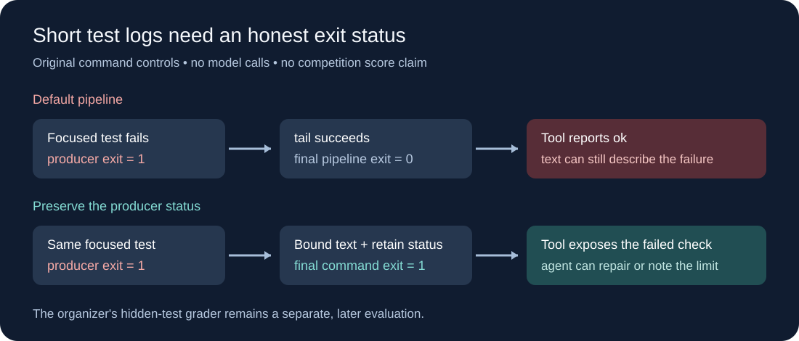

# Preserve the test result when shortening its output

Small coding agents need short test logs. A shell pipeline can accidentally make a failed test look successful to the tool layer. This study isolates that feedback problem and provides an original, stdlib-only command builder. It is a prospective Gemma experiment, with no claimed competition gain.



## What we learned from public agents

A fresh read of Kaggle's first 200 leaderboard rows at **17:54 UTC on October 11, 2026** shows the two leading displayed scores at **0.24**. These are team leaderboard observations, without submitted-package hashes or notebook-version linkage. The leading implementation remains unidentified in this study. [Official leaderboard](https://www.kaggle.com/competitions/gemma-4-developer-agent/leaderboard)

The saved October 10 **Budget-Fit** family prioritizes one bounded search, an early source edit, a focused test and submission before exploration consumes the budget. Its single-agent configuration uses 28 charged calls, thinking enabled and an eight-minute ceiling. The family supplies a useful testable workflow, but a leaderboard team link alone cannot establish which exact package produced a score. [Budget-Fit notebook](https://www.kaggle.com/code/verracodeguacas/gemma-4-agent-budget-fit-single-agent)

Fresh source reads at **17:55 UTC** bind Budget-Fit **V5**, the contract-first notebook **V3** and Black Cat **V13** to byte-identical October 10 source snapshots. Their API metadata omits a license field. This verifies the source versions studied, not permission to redistribute them or their submitted-package score lineage.

The **Black Cat / Rozen** lineage delegates localization to an analyzer and then uses a coder. The saved archive does not contain a per-task evaluation configuration. Its title and discussion history cannot substitute for a score bound to the exact archive. [Black Cat notebook](https://www.kaggle.com/code/lucifer19/black-cat-swe-agent-pack-instinct), [Rozen notebook](https://www.kaggle.com/code/romanrozen/gemma-eda-baseline-for-a-start-lb-top-1)

A notebook titled **LB 0.24** explicitly disclaims a measured score in its saved body; it implements a contract-first variation of the single-agent recipe. The title is a research lead, not demonstrated performance. The saved notebook bodies and metadata do not establish their individual license terms; no implementation or prompt text was copied here. [Contract-first notebook](https://www.kaggle.com/code/honghanhhh/gemma-4-baseline-lb-0-24)

Independent public work also reports repetition and edit-mechanics failures on a smaller stand-in model, carefully separating those from its official-model comparison. That supports measuring operational failures before adding more agents, while leaving transfer to the competition model unproven. [8kta research repository](https://github.com/8kta/kaggle-gemma4)

## A concrete gap in our current prompts

Both our saved `A_think` and native `D5b` prompt recommend a focused pytest command followed by `2>&1 | tail -15`. The pinned organizer Docker source runs ordinary Bash, and its command tool marks a zero shell exit as `ok`. Without `pipefail`, the pipeline returns the final `tail` status. Thus an invented failed producer exiting **1** yields an `ok` shell exit **0** when `tail` succeeds. The failure text may still be visible; this does not prove the agent misread it in a competition task.

The organizer's later grader runs separately. Fixing this command changes the agent's local feedback, not the grader, reference patches or hidden tests. Bash documents the pipeline-status rule and `pipefail`. [GNU Bash manual](https://www.gnu.org/s/bash/manual/bash.html#Pipelines)

## Try the original helper

```python
from bounded_verify import bounded_command

command = bounded_command(
    ["python", "-m", "pytest", "tests/test_example.py", "-x", "-q"],
    line_limit=15,
    byte_limit=3000,
)
# Pass command to your existing trusted run_command executor.
```

The helper builds text and never executes it. It quotes every argument, combines stderr with stdout, drains the producer, bounds the displayed tail and captures every pipeline status immediately. If the two trimming stages succeed, the final shell status equals the producer status. If either trimming stage fails, it returns **125** and the output is unverified. It prints a final status trailer after the cropped output.

The byte cap reserves room under a 5,000-character tool limit. A byte crop can split a UTF-8 character; a decoder may replace that character. Output size does not bound producer memory, duration, descendants or the size of a single line buffered by `tail`. Keep the existing trusted executor's timeout. This is a reporting helper, not a sandbox or command authorization layer; only provide a trusted argument vector.

```bash
python -m unittest discover -s . -p 'test_*.py'
python -O -m unittest discover -s . -p 'test_*.py'
```

The 18 invented controls cover status **0/1/2/3/4/5/127**, silent failure, stderr, long output, line and byte bounds, literal shell metacharacters, fake producer trailers, failed trimming and the deliberately broken comparison. No organizer harness, competition task, dataset payload or model was run. Native compatibility and score effect remain unqualified.

## Smallest useful prospective test

Keep `D5b`'s exact model, graph declarations, sampling, timeout, 28-call ceiling, 3.7-minute limit and task order. Change only its verification guidance: execute a bounded test pipeline under `bash -o pipefail -c`, inspect the actual returned code, and distinguish a failed assertion from no tests collected or an environment failure. This uses the existing `run_command` tool and adds no skill, registry entry, model or tool call. The reference helper above is more explicit, but need not be shipped to test this minimal correction.

Freeze package hashes and the planned public development task list before the coordinator runs the experiment. First require task-complete, source-bound receipts and runtime readiness. Compare paired solved outcomes, patches, verification exits, time and empty-patch rates. If there are `w` treatment-only solves and `l` control-only solves among `n` complete pairs, the development resolution change is `(w-l)/n`; report both counts and repeats, not only the mean. Already inspected public tasks are development evidence. Only a future exact completed official row can establish a competition score.

No current notebook or package was changed. Kaggle run coordination remains with Claude.
