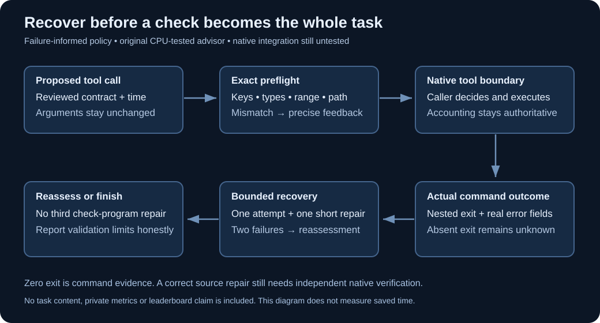

# Recover from a bad tool call before it becomes the whole task

Two separate experiments live here. The deterministic advisor is a standalone data-only library. The BudgetFit builder produces a derivative with an appended plain-text system-prompt checkpoint. That archive does not install or execute the advisor, has no new native callback, and supplies no evidence of saved time or charged calls. The derivative ZIP and all private task traces are outside this public folder.

A coding agent can know where the bug lives and still spend its entire session repairing the way it calls tools. A misspelled line-range key can silently fall back to the first page. A scratch-file write can fail because the file tool only accepts workspace paths. A broken check program can then become a second problem to debug.

`tool_feedback.py` is a small original advisor for that control-flow failure. It checks a proposed call against a supplied, reviewed primitive contract and returns a short decision. It never dispatches a tool, rewrites an argument, reads a repository, or retains commands and task content. A caller can surface the decision to its agent before deciding what to do next.



The layer checks exact argument keys and types, asks for explicit inclusive reads of at most 80 lines, and catches lexical workspace-path mistakes. It also tracks a task-wide allowance of two failed check attempts: one attempt and one short repair. Actual error fields or nonzero nested command exits outweigh a misleading success label. Missing exit evidence stays unknown. The remaining-time input lets the caller stop new investigation near the end of the session.

Inputs are deliberately small: at most 16 primitive arguments, 256 KiB per UTF-8 string, signed integers with magnitude below 2⁶³, and other numbers with magnitude at most 10¹². Remaining time must be a finite measured value from zero to 86,400 seconds. Unsupported schemas and recognized file-tool contract drift fail explicitly. Keep one advisor instance per task and deliver its events serially; concurrent dispatch is not supported by this treatment.

```python
from tool_feedback import ToolContract, ToolFeedback

advisor = ToolFeedback({
    "read_file": ToolContract(
        {"filepath": "string", "start_line": "integer", "end_line": "integer"},
        frozenset({"filepath"}),
    ),
})
decision = advisor.preflight(
    "read_file",
    {"filepath": "src/example.py", "start_line": 120, "end_line": 150},
    remaining_seconds=180,
)
print(decision.code)  # CONTRACT_OK
```

Run the invented controls on Python 3.12 or newer:

```sh
python3 run_controls.py --receipt controls-normal.json
python3 -O run_controls.py --receipt controls-optimized.json
```

Receipt files are created exclusively; choose a new name on a later run. These controls test the original advisor, including malformed keys, range boundaries, boolean-versus-integer mistakes, misleading result labels, missing exits, privacy and exhausted recovery. They do not run an agent or measure a score.

This is a stricter agent-policy treatment, not a claim that the native tools reject every input it flags. The runtime may coerce values that this layer rejects. Lexical paths do not prove filesystem containment; symlink checks remain the native tool's responsibility. Purpose labels, remaining time, contracts and outcome fields must come from a trusted integration adapter. The advisor cannot recognize a scratch command from its opaque text, infer a correct semantic fix, or prove a test's adequacy.

Coverage is limited to selected primitive-argument tools. A list-valued graph-tool schema is unsupported, so an adapter must leave that tool on its reviewed native route rather than blanket-intercepting every tool through this advisor. The controls' optional command timeout is an invented numeric-field fixture, not an assertion that the native command tool declares that argument. No fresh generated runtime schema is supplied here.

The proposed starting point is the credited [Budget-Fit V5 reference](https://www.kaggle.com/code/verracodeguacas/gemma-4-agent-budget-fit-single-agent?scriptVersionId=355310852), whose byte-exact reproduction is already documented in this repository. This package does not include that agent or change its configuration. BudgetFit has no installed advisor hook today. Any native treatment must first prove that feedback is actually delivered, preserve the unmodified reference as its control, retain all charged calls and elapsed time, and use the same model and evaluator. Do not report avoided charged calls until the hook's ordering is observed.

For a directly applicable configuration experiment, `build_prompt_treatment.py` appends one original tool-feedback checkpoint to the exact released reference's system prompt. It checks the complete upstream archive and all four member hashes first, preserves the other three files byte for byte, and emits a new derivative archive and terms in a new directory. This is a prompt-only treatment; it does not install the deterministic advisor. Obtain the reference using this repository's credited byte-exact reproducer, then run:

```sh
python3 build_prompt_treatment.py --reference /path/to/reference/submission.zip --output /new/path/to/treatment
```

The builder runs no foreign code. Its archive is source-only until native, competition-rule and compute admission gates pass. Do not publish a developer-agent package merely because this original helper is public. Keeping the exact reference as the control isolates the appended instruction block from unrelated sampling and budget changes, but does not isolate the block's individual sentences from each other.

One retained failure informed this design. Replaying that failure can confirm the mechanism, but it cannot establish independent task quality. A registered matched comparison and complete native verification remain necessary before an official submission. No score gain, native readiness, quota admission or paid compute permission is claimed. Current opening artwork stays unchanged.
