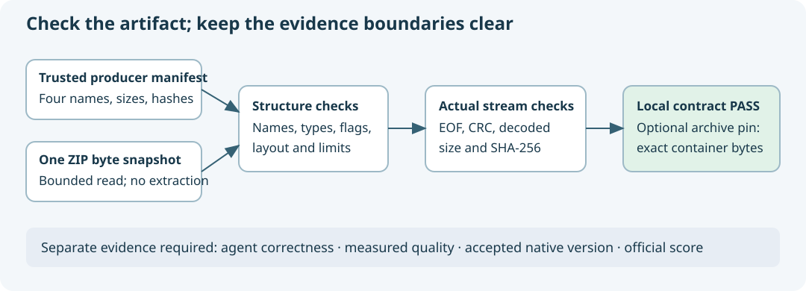

# Check a four-file agent ZIP before trusting its provenance

This small, original Python toolkit checks whether a ZIP contains exactly the
four files named in an independently trusted producer manifest, with exact
sizes and SHA-256 hashes. It never extracts files, parses agent configuration,
runs an agent, contacts Kaggle, or submits anything. Python 3.10+ and its standard
library are sufficient.



## Try the invented examples

Run these commands from this directory:

```sh
python3 audit_zip.py fixtures/valid_stored.zip fixtures/producer_manifest.json
python3 audit_zip.py fixtures/changed_content.zip fixtures/producer_manifest.json
python3 -m unittest -v test_audit.py
python3 make_fixtures.py ./my-new-fixtures
```

The first command returns JSON with `status: PASS`, the archive hash and four
measured member hashes. The second returns `HASH_MISMATCH` and exit status 1.
The generator requires a new destination directory and never overwrites one.
The checked-in cases reproduce byte for byte, including the valid method-8
example: it uses an explicitly encoded uncompressed DEFLATE block rather than
depending on a compression-library version. This illustrates format validity,
not compression efficiency.

The [dataset card](DATASET_CARD.md) describes all eleven wholly invented
examples. [cases.csv](fixtures/cases.csv) records their expected outcomes,
sizes and hashes. Their configuration text is deliberately illustrative and
is **not a working Gemma agent or a competition submission**.

## Use a real producer manifest

The schema is `four-member-producer-manifest/1`; the exact keys are `schema`
and `members`. Each member maps to an integer `bytes` count and a lowercase
`sha256`. The four required names are:

```text
agent.yaml
configs/sampling.yaml
eval_config.yaml
prompts/system.md
```

Get the manifest from a separately trusted producer record. Generating it from
the same untrusted ZIP would only describe that ZIP; it would not establish
that the producer's intended files were supplied.

Member equivalence and exact archive identity are different checks.
`valid_timestamp.zip` and `valid_deflated.zip` both pass the invented member
manifest, but have different archive hashes from `valid_stored.zip`. Use the
optional `--expected-archive-sha256 HASH` argument to require exact container
bytes as well. A wrong pin returns `ARCHIVE_HASH_MISMATCH` before member audit.
The reported archive hash binds the same bounded byte snapshot that was audited.

### Example: the accepted faithful V10 reproduction archive

[faithful_v10_manifest.json](faithful_v10_manifest.json) contains only the four
public size/hash facts, not upstream configuration or prompt content. The
separate [archive receipt](faithful_v10_archive_pin.json) records the accepted
V31 native downloadable artifact's 3,713-byte pin, also matching the retained
15 October output. After rebuilding the existing, separately
licensed [faithful recipe at its published commit](https://github.com/cubres/gemma-4-developer-agent/tree/527f2c4180fe41166bf0250d3175495ead2d2a39/reproductions/budget-aware-v10),
check member equivalence:

```sh
python3 audit_zip.py /path/to/rebuilt-submission.zip faithful_v10_manifest.json
```

For exact identity of that accepted downloadable archive, also require its recorded pin:

```sh
python3 audit_zip.py /path/to/submission.zip faithful_v10_manifest.json \
  --expected-archive-sha256 6ff73d104725cc31deadd18787f3f55e5ce534889cec82387e3b280637d34887
```

The reviewed local rebuild matches that pin too. A different compression
implementation can change container bytes while preserving all four members;
the first command checks that narrower, portable property.

A PASS proves this local byte contract. It does not establish which bytes a
remote judge consumed, configuration correctness, a completed score, or a
native notebook/version association.

## Deliberately narrow ZIP contract

The auditor accepts stored or deflated regular files in a plain single-disk
ZIP, with no directory entries, extra fields, comments, data descriptors,
ZIP64 records, archive prefixes or trailing bytes. This is a strict producer
contract, not a general ZIP compatibility checker. A legitimate archive using
those unsupported features is rejected. There is no extraction or execution.

| Bound or rejection | Behavior |
| --- | --- |
| Archive / manifest input | At most 8 MiB / 16 KiB, read with a size bound |
| Each decoded member / decoded total | At most 1 MiB / 4 MiB |
| Members | Exactly four names, no duplicates or unexpected entries |
| Paths and file types | Reject traversal, NUL, absolute, backslash and dot components; reject symlinks and nonregular types |
| Encryption or other compression | Reject before decoding |
| Header disagreement, CRC, size or hash mismatch | Reject; no partial success |
| Actual DEFLATE stream | Require bounded output, EOF and no hidden suffix |

The forged-prefix example demonstrates why an ordinary ZIP member read plus
its CRC can be insufficient: Python's ZIP reader can return a declared valid
prefix while hiding extra decompressed bytes. The auditor independently checks
the actual compressed stream. The input limits bound this implementation's
reads; they are not a formal CPU/RSS containment or hostile-file sandbox claim.

## Provenance and honest results

The motivating public recipe is Igor Zharov / flexonafft's
[Budget-Aware V10, native version 357955943](https://www.kaggle.com/code/flexonafft/gemma-4-budget-aware-coding-agent-v2/input?scriptVersionId=357955943),
whose indexed public page showed **0.22** in the October 2026 refresh. Its
source was observed under Apache 2.0 on 15 October; the refresh found identical
source bytes. The existing faithful reproduction retains its Apache license,
NOTICE and credits to flexonafft, Matterhorn3838, verracodeguacas and Google/Kaggle.

The coordinator's current accepted record for
[our V31, native version 358738566](https://www.kaggle.com/code/prvsiyan/gemma-and-the-shape-of-doubt?scriptVersionId=358738566)
is COMPLETE with score **0.17** and that native version link; visible-badge
checking remains separate. In the October 18 refresh, the coordinator downloaded
the ZIP through the accepted native Submission Details for V31. Independent
local audit confirms 3,713 bytes, the exact archive pin above and all four member
hashes; it equals the retained 15 October output. This establishes the accepted
native downloadable artifact's bytes. It does not reveal hidden judge internals.
The accepted metadata still reports `totalBytes: 88266` (a native 86 KiB
annotation); that size annotation remains unexplained. No expansion or
repackaging cause is inferred, and no consumed attempt is replayed.

The checker, tests, invented examples and their documentation are original
2026 cubres/prvsiyan work under [MIT](LICENSE). That license does not relicense
the separate upstream recipe, official harness, models or competition data.
No real task rows, issue text, gold patches, model weights, wheel files,
credentials or private captures are included. This packet has no new official
score and no completed quality experiment. Public home:
[cubres/gemma-4-developer-agent](https://github.com/cubres/gemma-4-developer-agent).
